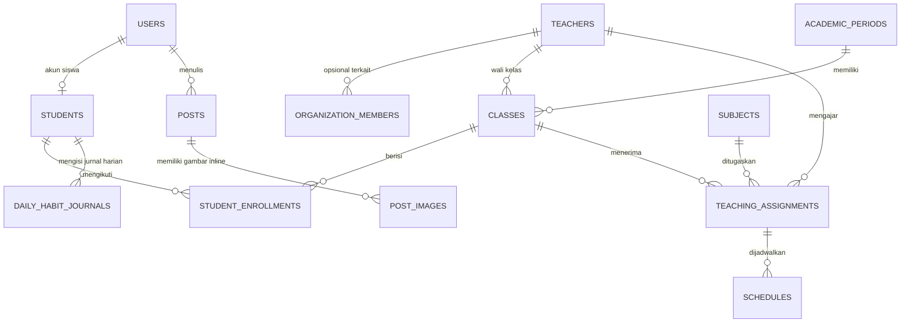

# PRODUCT REQUIREMENTS DOCUMENT (PRD)

## 4U - Sistem Informasi Administrasi Akademik SD No. 4 Ungasan

| Metadata | Nilai |
|---|---|
| Versi dokumen | v1.0 |
| Status dokumen | Baseline scope acuan utama prototype dan implementasi |
| Tanggal pembaruan | 13 September 2026 |
| Jenis proyek | Tugas akhir mata kuliah Pemrograman Internet |
| Tim | Gde Santha Wijaya & I Gusti Ngurah Dwi Sedana Yoga |
| Target rilis | Versi web daring yang stabil untuk demonstrasi UAS |
| Arsitektur MVP | Monolith Laravel; tidak memakai frontend-backend terpisah |
| Pemilik produk | Tim mahasiswa; dosen sebagai evaluator |

> **Keputusan inti:** Proyek mengutamakan kelengkapan CRUD, ketepatan relasi data, keamanan akses berbasis role, dan kemampuan tim menjelaskan sistem. Teknologi tambahan tidak boleh mengganggu penyelesaian MVP.

---

# 1. OVERVIEW

## 1.1 Nama Proyek

**Sistem Informasi Administrasi Akademik SD No. 4 Ungasan**, disingkat **4U**.

## 1.2 Latar Belakang

Informasi sekolah sering tersebar di dokumen, spreadsheet, grup percakapan, dan pengumuman manual. Kondisi ini menyulitkan pengelolaan data siswa dan guru, penempatan kelas, penyusunan jadwal, serta penyampaian informasi kepada siswa dan masyarakat.

**Sistem Informasi Manajemen (SIM)** adalah sistem berbasis komputer yang menyediakan informasi yang diperlukan oleh organisasi untuk mengelola operasional, administrasi, dan pengambilan keputusan secara terpusat dan terstruktur.

Aplikasi **4U** dirancang sebagai aplikasi web terpusat yang menyediakan halaman informasi publik, panel administrasi dengan CRUD penuh, serta portal siswa untuk informasi jadwal dan jurnal harian. Guru dikelola sebagai data tenaga pendidik untuk direktori, wali kelas, penugasan, jadwal, dan struktur organisasi; guru bukan pengguna yang memiliki akun login. Proyek ini menjadi sarana pembelajaran pengembangan web berbasis database, autentikasi, otorisasi, validasi, desain antarmuka, pengujian, dan deployment.

## 1.3 Tujuan Proyek

1. Memusatkan data siswa, guru, kelas, mata pelajaran, jadwal, dan konten sekolah.
2. Memungkinkan admin melakukan CRUD tanpa mengubah database secara langsung.
3. Menyediakan satu halaman siswa yang menampilkan identitas minimum, kelas/periode aktif, serta jadwal kelas yang tepat.
4. Menyediakan informasi sekolah, direktori guru, berita, dan pengumuman kepada publik.
5. Menerapkan autentikasi session serta pembatasan akses hanya untuk Admin dan Siswa.
6. Menyelesaikan dan meninjau prototype UI yang dapat diklik sebelum menghubungkannya ke Laravel, MySQL, dan autentikasi.
7. Menghasilkan aplikasi daring yang dapat didemonstrasikan dan dijadikan portofolio bisnis-teknologi setelah versi lokal stabil.
8. Menyediakan modul Jurnal 7 Kebiasaan Anak Hebat pada Portal Siswa agar siswa/orang tua dapat mencatat kebiasaan harian anak, dan admin/sekolah dapat merekap serta mengekspor data tersebut.

## 1.4 Sasaran Keberhasilan

Produk dianggap siap demo apabila:

- Seluruh fitur MVP dapat dijalankan melalui antarmuka web tanpa operasi database manual.
- Admin dapat membuat akun siswa, menempatkan siswa ke kelas aktif, dan mengelola jadwal.
- Siswa hanya dapat membuka Portal Siswa miliknya sendiri, berisi halaman ringkas (nama, NISN, kelas aktif, periode aktif, jadwal kelas) dan modul Jurnal 7 Kebiasaan Anak Hebat.
- Siswa dapat mengisi dan mengubah jurnal 7 kebiasaan untuk tanggal apa saja melalui kalender, dan admin dapat merekap serta mengekspor seluruh jurnal ke Excel/CSV.
- Guru tidak memiliki akun atau akses privat; seluruh data guru dikelola oleh admin.
- Publik hanya dapat melihat informasi yang berstatus aktif atau terbit.
- Pengguna yang tidak berhak menerima respons 403 atau dialihkan secara aman.
- Prototype seluruh halaman dapat diklik dan selesai direview sebelum integrasi backend dimulai.
- Data uji tersedia; aplikasi lokal harus stabil sebelum deployment ke server dengan HTTPS.
- Kedua anggota mampu menjelaskan alur permintaan, model data, role, dan satu fitur end-to-end.

## 1.5 Prinsip Produk

- **Data relasional sebagai sumber kebenaran:** hindari duplikasi kelas, guru, dan jadwal.
- **Privasi secara default:** data siswa tidak pernah ditampilkan di halaman publik.
- **Arsip, bukan kehilangan data:** alumni dan data terpakai dinonaktifkan atau diarsipkan.

---

# 2. SCOPE

## 2.1 Fitur Wajib (MVP)

| ID | Fitur | Hasil minimum yang wajib tersedia |
|---|---|---|
| MVP-01 | Halaman profil sekolah | Nama, identitas, kontak, visi, misi, dan struktur organisasi dapat dibaca publik dan dikelola admin. |
| MVP-02 | Direktori guru publik | Foto, nama, serta jabatan/bidang mengajar guru aktif ditampilkan kepada publik. |
| MVP-03 | Berita dan pengumuman | Publik melihat konten terbit; admin membuat, mengubah, menerbitkan, dan menghapus/mengarsipkan konten melalui editor rich-text, termasuk satu gambar sampul dan beberapa gambar inline di antara paragraf. |
| MVP-04 | Autentikasi dan role | Login berbasis session, logout, status akun aktif, dan redirect hanya sesuai role Admin/Siswa. Tidak ada registrasi publik atau akun guru. |
| MVP-05 | CRUD siswa | Admin menambah biodata dan akun, mengubah data, menempatkan ke kelas, serta mengarsipkan alumni. |
| MVP-06 | CRUD guru | Admin mengelola biodata, foto, status aktif, jabatan publik, keterkaitan organisasi, wali kelas, dan penggunaan guru pada penugasan; guru tidak memiliki akun. |
| MVP-07 | Data akademik | Admin mengelola periode akademik, kelas, wali kelas, mata pelajaran, dan penempatan siswa. |
| MVP-08 | Penugasan dan jadwal | Admin memasangkan guru-mapel-kelas dan menyusun jadwal Senin-Sabtu dengan pemeriksaan bentrok dasar. |
| MVP-09 | Portal siswa (halaman ringkas) | Siswa melihat nama, NISN, kelas aktif, tahun ajaran/semester aktif, dan jadwal Senin-Sabtu beserta guru pengampu dan ruang pada satu halaman read-only. |
| MVP-11 | Jurnal 7 Kebiasaan Anak Hebat (Siswa) | Siswa memilih tanggal pada kalender di Portal Siswa dan mengisi form 7 kebiasaan (bangun pagi, ibadah, olahraga, makan, belajar, bermasyarakat, tidur); checklist ibadah menyesuaikan agama siswa; data tersimpan/ter-update per tanggal. |
| MVP-12 | Rekap Jurnal 7 Kebiasaan (Admin) | Admin melihat rekap seluruh jurnal siswa dalam tabel data dengan filter bulan/kelas/nama, serta dapat mengekspor hasil ke Excel/CSV sesuai struktur kolom yang ditentukan. |
| MVP-10 | Deployment dan data demo | Setelah aplikasi lokal selesai, aplikasi daring, konfigurasi produksi aman, akun demo Admin/Siswa, seed data (termasuk contoh data jurnal), dan backup database tersedia. |

### Batas MVP

- CRUD dilakukan melalui halaman server-rendered; tidak ada SPA atau REST API publik.
- Admin adalah satu-satunya role yang mengubah data akademik dan konten.
- Siswa hanya membaca data ringkas dan jadwal yang berasal dari akun serta enrollment miliknya; satu-satunya data yang boleh siswa buat/ubah sendiri adalah entri Jurnal 7 Kebiasaan miliknya.
- Guru tidak mempunyai akun, autentikasi, dashboard, route privat, atau kemampuan mengubah data.
- Portal Siswa terdiri dari halaman ringkas (read-only) dan modul Jurnal 7 Kebiasaan (create/update harian); profil lengkap siswa, halaman wali kelas, dan daftar guru terpisah tetap berada di luar scope.
- Editor artikel MVP mendukung paragraf, heading sederhana, penekanan teks, daftar, tautan, satu gambar sampul, dan maksimal 10 gambar inline per artikel.
- Penyusunan galeri, crop gambar, floating kiri/kanan, dan drag-and-drop lanjutan tidak wajib pada MVP.
- Kalender pada Jurnal 7 Kebiasaan hanya date-picker sederhana untuk memilih tanggal entri milik siswa sendiri. Nilai, presensi, dan pembayaran tetap tidak termasuk MVP.

## 2.2 Fitur Tambahan (Jika Waktu Memungkinkan)

Fitur berikut hanya dikerjakan setelah seluruh tes MVP lulus:

1. Pencarian, filter, sortir, dan pagination lanjutan pada panel admin.
2. Ekspor daftar siswa, guru, atau jadwal ke CSV/PDF (di luar ekspor Jurnal 7 Kebiasaan, yang sudah menjadi bagian MVP-12).
3. Dashboard statistik ringkas: jumlah siswa aktif, guru aktif, kelas, dan konten terbit.
4. Audit log perubahan penting oleh admin.
5. Penggantian password mandiri dan alur lupa password melalui email.
6. Optimasi otomatis foto menjadi ukuran dan format web.
7. REST API terdokumentasi untuk integrasi masa depan.
8. Dashboard BI terpisah dari salinan data anonim/agregat.
9. Pustaka media, crop gambar, galeri/carousel, dan pengaturan tata letak gambar lanjutan.

## 2.3 Di Luar Scope

- Nilai, rapor, presensi, pembayaran/SPP, PPDB, perpustakaan, dan inventaris.
- Role/akun orang tua/wali terpisah (Jurnal 7 Kebiasaan tetap diisi lewat akun Siswa yang sama, bukan akun baru untuk orang tua), aplikasi mobile native, chat, notifikasi WhatsApp, dan email massal.
- Akun atau role guru, login guru, dashboard guru, jadwal privat guru, dan daftar siswa untuk guru.
- Profil lengkap siswa di portal, halaman wali kelas siswa, serta halaman daftar guru mata pelajaran siswa yang terpisah.
- Multi-sekolah/multi-tenant, microservices, single sign-on, OAuth sosial, atau autentikasi JWT.
- Migrasi data sekolah nyata dalam jumlah besar; demo menggunakan data sintetis.

---

# 3. USER ROLES & PERMISSIONS

## 3.1 Definisi Role

- **Publik:** pengunjung yang belum login.
- **Siswa:** pengguna yang terhubung tepat ke satu profil siswa.
- **Admin:** pengelola seluruh data dan konten sistem.

Guru bukan role aplikasi. Istilah **guru** di seluruh dokumen setelah bagian ini berarti entitas/data tenaga pendidik yang dikelola Admin.

Orang tua/wali juga bukan role aplikasi. Pengisian Jurnal 7 Kebiasaan Anak Hebat dilakukan menggunakan akun **Siswa**; sistem tidak membedakan apakah yang mengetik adalah siswa atau orang tuanya, dan tidak ada autentikasi/akun terpisah untuk orang tua.

Legenda: **C** = create, **R** = read, **U** = update, **D** = delete, **A** = archive/nonaktifkan, **-** = tidak diizinkan.

## 3.2 Matriks Izin

| Sumber daya/aktivitas | Publik | Siswa | Admin |
|---|---:|---:|---:|
| Profil sekolah aktif | R | R | C/R/U |
| Struktur organisasi aktif | R | R | C/R/U/D |
| Direktori guru publik | R | R | C/R/U/A |
| Berita/pengumuman terbit | R | R | C/R/U/D/A |
| Login/logout | Login | Login/logout | Login/logout |
| Data siswa lengkap | - | - | C/R/U/A |
| Nama dan NISN siswa sendiri | - | R | C/R/U/A |
| Kelas dan periode aktif siswa sendiri | - | R | C/R/U/D |
| Jadwal kelas siswa sendiri beserta guru dan ruang | - | R | C/R/U/D |
| Jurnal 7 Kebiasaan Anak Hebat milik sendiri | - | C/R/U | R (rekap + export, tidak mengubah isi) |
| Data guru | - | - | C/R/U/A |
| Periode akademik, kelas, mapel, dan enrollment | - | - | C/R/U/A |
| Penugasan guru-mapel-kelas dan jadwal | - | - | C/R/U/D |
| Akun pengguna dan role Admin/Siswa | - | - | C/R/U/A |

## 3.3 Aturan Otorisasi

1. Route `/admin` dan `/siswa` wajib melewati autentikasi session serta pemeriksaan role.
2. Siswa hanya boleh mengambil data melalui `auth()->user()->student`, bukan ID siswa bebas dari URL.
3. Siswa hanya menerima nama, NISN, kelas/periode aktif, serta slot jadwal kelas beserta nama guru dan ruang.
3a. Siswa hanya boleh membuat/membaca/mengubah entri Jurnal 7 Kebiasaan miliknya sendiri; siswa dapat memilih tanggal apa saja pada kalender, termasuk tanggal lampau, tetapi tidak untuk tanggal yang belum terjadi (lebih besar dari hari ini). Admin hanya berhak membaca dan mengekspor jurnal seluruh siswa, tidak mengubah isinya.
4. Admin tidak boleh menghapus akun yang sedang dipakai dirinya sendiri tanpa proses pengalihan admin.
5. Akun siswa alumni/arsip tidak dapat login.
6. Guru tidak memiliki record `users`, kredensial, session, atau route privat.
7. Perubahan status akun, role, penempatan kelas, data guru, penugasan, dan jadwal hanya dilakukan admin.

---

# 4. DATA MODEL

## 4.1 Entitas dan Field Penting

### 4.1.1 `users`

Menyimpan kredensial dan role, bukan seluruh biodata.

- `id` (primary key)
- `username` (unik dan wajib; dapat menggunakan NISN untuk akun awal siswa)
- `email` (opsional, unik bila diisi)
- `password` (hasil hash, tidak pernah plaintext)
- `role` (hanya `admin` atau `siswa`)
- `is_active` (menentukan apakah akun dapat login)
- `last_login_at` (waktu login terakhir, nullable)
- `remember_token`, `created_at`, `updated_at`

### 4.1.2 `school_profiles`

Satu record aktif untuk identitas sekolah.

- `id`, `school_name`, `address`, `phone`, `email`
- `vision`, `mission`, `logo_path`
- `updated_by` (foreign key ke `users`)
- `created_at`, `updated_at`

### 4.1.3 `teachers`

- `id` (primary key)
- `nip` (nullable dan unik)
- `name`, `gender`, `birth_place`, `birth_date`
- `address`, `phone`, `email`
- `photo_path`, `public_title` (contoh: Guru Matematika)
- `is_public`, `is_active`, `deleted_at`, timestamps

### 4.1.4 `organization_members`

Mewakili kepala sekolah, komite, tata usaha, atau guru yang masuk struktur.

- `id` (primary key)
- `teacher_id` (nullable; diisi jika anggota organisasi juga merupakan guru)
- `name` (digunakan untuk anggota non-guru)
- `position_name` (contoh: Kepala Sekolah, Ketua Komite, Tata Usaha)
- `category` (`kepala_sekolah`, `komite`, `tata_usaha`, atau `lainnya`)
- `photo_path`, `display_order`, `is_active`, timestamps

### 4.1.5 `students`

- `id` (primary key)
- `user_id` (wajib dan unik)
- `nisn` (wajib dan unik)
- `nis` (opsional dan unik bila diisi)
- `name`, `gender`, `birth_place`, `birth_date`
- `address`, `parent_name`, `parent_phone` (kontak orang tua tidak pernah publik)
- `religion` (enum `islam`, `kristen`, `katolik`, `hindu`, `buddha`, `konghucu`, atau `lainnya`; diisi Admin dan dipakai untuk menentukan daftar checklist ibadah pada Jurnal 7 Kebiasaan)
- `status` (`aktif`, `alumni`, atau `arsip`)
- `graduation_year` (nullable)
- `deleted_at`, timestamps

### 4.1.6 `academic_periods`

- `id` (primary key)
- `academic_year` (contoh: `2026/2027`)
- `semester` (`ganjil` atau `genap`)
- `start_date`, `end_date`, `is_active`, timestamps
- Kombinasi `academic_year + semester` wajib unik; hanya satu periode boleh aktif.

### 4.1.7 `classes`

- `id` (primary key)
- `academic_period_id` (foreign key)
- `name` (contoh: `1A`, `2B`)
- `grade_level`, `room`
- `homeroom_teacher_id` (nullable, foreign key ke `teachers`)
- `is_active`, timestamps
- Kombinasi `academic_period_id + name` wajib unik.

### 4.1.8 `student_enrollments`

Tabel penghubung untuk menyimpan riwayat kelas siswa.

- `id`, `student_id`, `class_id` (foreign keys)
- `enrolled_at`, `ended_at` (`ended_at` nullable)
- `status` (`aktif`, `selesai`, atau `pindah`)
- timestamps
- Satu siswa maksimal memiliki satu enrollment aktif pada satu periode akademik.

### 4.1.9 `subjects`

- `id`, `code` (unik), `name`, `description`
- `is_active`, timestamps

### 4.1.10 `teaching_assignments`

Menghubungkan guru, mata pelajaran, dan kelas.

- `id`, `teacher_id`, `subject_id`, `class_id` (foreign keys)
- `is_active`, timestamps
- Kombinasi `teacher_id + subject_id + class_id` wajib unik.

### 4.1.11 `schedules`

- `id` (primary key)
- `teaching_assignment_id` (foreign key)
- `day_of_week` (Senin sampai Sabtu)
- `start_time`, `end_time`, `room`, `notes`, timestamps
- `end_time` wajib lebih besar dari `start_time`
- Sistem menolak bentrok kelas dan bentrok guru pada hari serta interval waktu yang sama.

### 4.1.12 `posts`

Menyimpan berita dan pengumuman pada satu tabel.

- `id`, `author_user_id` (foreign key ke `users`)
- `type` (`berita` atau `pengumuman`)
- `title`, `slug` (unik), `excerpt`, `body_html`, `cover_image_path`, `cover_alt_text`
- `body_html` menyimpan struktur paragraf dan referensi gambar inline sesuai posisi dari editor setelah melalui sanitasi server-side
- `cover_alt_text` wajib ketika gambar sampul diisi
- `status` (`draft`, `published`, atau `archived`)
- `published_at`, `deleted_at`, timestamps

### 4.1.13 `post_images`

Mencatat kepemilikan dan metadata gambar inline agar file dapat divalidasi dan dibersihkan dengan aman.

- `id`, `post_id` (foreign key ke `posts`)
- `file_path` (path file pada storage publik)
- `alt_text` (deskripsi gambar untuk aksesibilitas)
- `caption` (keterangan gambar opsional)
- `created_at`, `updated_at`

### 4.1.14 `daily_habit_journals`

Mencatat entri harian Jurnal 7 Kebiasaan Anak Hebat, diisi lewat akun Siswa (dalam praktik sering oleh orang tua).

- `id` (primary key)
- `student_id` (foreign key ke `students`)
- `journal_date` (tanggal entri; dipilih bebas oleh siswa lewat kalender, termasuk tanggal lampau, tidak boleh lebih besar dari hari ini)
- `wake_up_time` (jam bangun pagi - time)
- `worship_items` (daftar ibadah yang dicentang, disimpan sebagai JSON array)
- `exercise_activity` (teks bebas kegiatan olahraga)
- `meal_breakfast`, `meal_lunch`, `meal_dinner` (teks bebas menu makan pagi/siang/malam)
- `learning_activity` (teks bebas kegiatan belajar)
- `social_activity` (teks bebas kegiatan bermasyarakat/sosial)
- `sleep_time` (jam tidur malam - time)
- `created_at`, `updated_at`
- Kombinasi `student_id + journal_date` wajib unik (upsert per tanggal).

### 4.1.15 Tabel Teknis Framework

Laravel dapat menambahkan `migrations`, `sessions`, `cache`, `jobs`, dan `password_reset_tokens`. Tabel tersebut bukan entitas bisnis dan tidak ditampilkan dalam menu admin.

## 4.2 Relasi Antarentitas

- `users` one-to-zero/one `students`; satu akun siswa terhubung satu profil siswa.
- `users` one-to-many `posts`; satu user ber-role admin dapat menulis banyak konten.
- `posts` one-to-many `post_images`; satu artikel dapat memiliki banyak gambar inline.
- `teachers` one-to-many `classes` melalui `homeroom_teacher_id`.
- `teachers` one-to-many `organization_members` secara opsional.
- `academic_periods` one-to-many `classes`.
- `students` many-to-many `classes` melalui `student_enrollments` untuk menjaga riwayat.
- `students` one-to-many `daily_habit_journals`; satu siswa dapat memiliki banyak entri jurnal harian.
- `teachers`, `subjects`, dan `classes` terhubung melalui `teaching_assignments`.
- `teaching_assignments` one-to-many `schedules`.

## 4.3 ERD Sederhana



Versi baca cepat:

```text
User ---> 0..1 Siswa ---> Enrollment ---> Kelas ---> Periode Akademik
  |                         |               |
  |                         +---> Jurnal 7 Kebiasaan (harian)
  +---> Berita/Pengumuman                   |---> Wali Kelas ---> Guru
           +---> Gambar Inline              +---> Penugasan ---> Guru
                                                   |
                                                   |---> Mata Pelajaran
                                                   +---> Jadwal

Guru ---> Anggota Struktur Organisasi (opsional)
```

## 4.4 Aturan Integritas Data

1. NISN, username, kode mata pelajaran, slug post, dan kombinasi periode akademik wajib unik.
2. Penghapusan periode, kelas, mapel, atau guru ditolak jika masih memiliki referensi aktif; gunakan nonaktif/arsip.
3. Satu periode akademik saja yang boleh berstatus aktif.
4. Satu siswa memiliki maksimum satu kelas aktif per periode.
5. Jadwal tidak boleh bentrok pada kelas atau guru yang sama.
6. Hari jadwal dibatasi Senin-Sabtu.
7. File foto tidak disimpan sebagai binary database; database hanya menyimpan path.
8. Gambar inline wajib terkait dengan satu post dan dihapus secara aman ketika tidak lagi direferensikan oleh artikel.
9. Satu artikel memiliki maksimum satu gambar sampul dan 10 gambar inline aktif.
10. Record guru tidak memiliki relasi akun pengguna dan tidak dapat digunakan untuk autentikasi.
11. Kombinasi `student_id + journal_date` pada `daily_habit_journals` wajib unik; penyimpanan ulang pada tanggal yang sama meng-update record lama, bukan menambah record baru.
12. Tanggal jurnal tidak boleh lebih besar dari hari ini (tidak bisa mengisi untuk tanggal mendatang); tanggal lampau tidak dibatasi.
13. Opsi checklist `worship_items` pada form jurnal ditentukan oleh `students.religion`; siswa tanpa `religion` terisi menampilkan pesan agar admin melengkapi data terlebih dahulu.

---

# 5. FITUR PER MODUL

## 5.1 Modul Halaman Publik

### A. Profil Sekolah dan Struktur Organisasi

- **Aktor:** Publik sebagai pembaca; Admin sebagai pengelola.
- **Input admin:** identitas sekolah, kontak, visi, misi, logo, nama/jabatan/foto anggota organisasi, dan urutan tampil.
- **Flow:** admin membuka pengaturan -> mengubah data -> sistem memvalidasi -> menyimpan -> halaman publik menampilkan record aktif sesuai urutan.
- **Output:** halaman profil sekolah dan struktur Kepala Sekolah, Komite, serta Tata Usaha.
- **Kriteria penerimaan:** pengunjung tanpa login dapat membaca data; anggota nonaktif tidak ditampilkan; data kosong tidak merusak layout.

### B. Direktori Guru

- **Aktor:** Publik dan Admin.
- **Input admin:** nama, foto, gelar/jabatan mengajar, dan status publik.
- **Flow:** admin mengelola guru -> menandai `is_public` dan `is_active` -> sistem menampilkan kartu guru publik.
- **Output:** daftar guru responsif dan detail ringkas.
- **Kriteria penerimaan:** hanya guru aktif dan publik yang tampil; alamat pribadi dan nomor sensitif tidak ditampilkan.

### C. Berita dan Pengumuman

- **Aktor:** Publik dan Admin.
- **Input admin:** tipe, judul, ringkasan, isi melalui editor rich-text, satu gambar sampul, maksimal 10 gambar inline, alt text, caption opsional, status, dan tanggal terbit.
- **Flow:** admin membuat draft -> menulis paragraf -> menempatkan kursor di antara paragraf -> mengunggah dan menyisipkan gambar inline -> pratinjau -> menyimpan draft atau menerbitkan -> konten muncul pada daftar dan halaman detail.
- **Output:** daftar konten terbaru, detail berdasarkan slug, pemisahan berita/pengumuman, serta artikel yang mempertahankan urutan paragraf dan gambar.
- **Kriteria penerimaan:** draft/arsip tidak dapat dibaca publik; isi kosong dan slug duplikat ditolak; gambar responsif pada layar ponsel dan desktop; konten HTML disanitasi sebelum ditampilkan.

## 5.2 Modul Autentikasi dan Akun

- **Aktor:** Admin dan Siswa. Publik hanya dapat membuka form login.
- **Input:** username dan password; akun dibuat oleh admin. Guru tidak memiliki akun.
- **Flow login:** validasi -> rate limit -> verifikasi hash -> cek akun aktif -> buat session -> redirect `/admin` untuk role `admin` atau `/siswa` untuk role `siswa`.
- **Output:** session pengguna, halaman sesuai role, atau pesan error generik.
- **Flow logout:** pengguna mengirim POST logout -> session dihapus dan token CSRF diperbarui -> kembali ke halaman login.
- **Kriteria penerimaan:** tidak ada registrasi publik; enum role hanya `admin`/`siswa`; password tidak pernah tampil; pengguna tidak dapat membuka route role lain; tidak ada kredensial atau session untuk data guru.

## 5.3 Modul Admin - Data Siswa

- **Input:** NISN, NIS opsional, biodata, alamat, kontak orang tua, kelas aktif, username, password awal, dan status.
- **Create flow:** isi form -> validasi unik -> buat `users` dan `students` dalam transaksi -> buat enrollment aktif -> tampilkan hasil.
- **Update flow:** pilih siswa -> ubah biodata/kelas -> tutup enrollment lama jika kelas berubah -> buat enrollment baru.
- **Archive flow:** pilih status alumni/arsip -> masukkan tahun kelulusan bila alumni -> nonaktifkan akun -> simpan riwayat kelas.
- **Output:** daftar siswa terpaginasikan, detail siswa, status akun, kelas aktif, dan pesan keberhasilan/kegagalan.
- **Kriteria penerimaan:** kegagalan salah satu proses membatalkan seluruh transaksi; NISN duplikat ditolak; siswa arsip tidak dapat login.

## 5.4 Modul Admin - Data Guru dan Organisasi

- **Input:** NIP opsional, biodata, foto, jabatan publik, status aktif/publik, dan posisi organisasi.
- **Flow:** admin membuat/mengubah guru -> validasi -> simpan foto pada storage publik -> simpan path -> atur status direktori/organisasi -> gunakan record guru untuk wali kelas atau penugasan bila relevan.
- **Output:** daftar guru, detail data guru, tampilan direktori publik, keterkaitan wali kelas/penugasan/organisasi, tanpa akun login.
- **Kriteria penerimaan:** file selain gambar atau melebihi batas ditolak; menonaktifkan guru tidak menghapus riwayat kelas, penugasan, atau jadwal; sistem tidak menyediakan username, password, role, atau tombol login untuk guru.

## 5.5 Modul Admin - Periode, Kelas, dan Penempatan

- **Input:** tahun akademik, semester, tanggal, nama kelas, tingkat, ruang, wali kelas, serta daftar siswa.
- **Flow:** admin membuat periode -> mengaktifkan satu periode -> membuat kelas -> memilih wali -> menempatkan siswa.
- **Output:** daftar kelas per periode, wali kelas, jumlah siswa, serta riwayat enrollment.
- **Kriteria penerimaan:** kombinasi periode/nama kelas unik; wali harus guru aktif; siswa tidak boleh memiliki dua kelas aktif pada periode sama.

## 5.6 Modul Admin - Mata Pelajaran dan Penugasan Mengajar

- **Input:** kode/nama mapel, guru, kelas, dan status penugasan.
- **Flow:** buat mapel -> pilih guru/mapel/kelas -> sistem memeriksa duplikasi -> simpan penugasan.
- **Output:** matriks sederhana guru-mapel-kelas yang menjadi dasar jadwal.
- **Kriteria penerimaan:** guru, mapel, dan kelas harus aktif; kombinasi penugasan duplikat ditolak.

## 5.7 Modul Admin - Jadwal Mingguan

- **Input:** penugasan mengajar, hari Senin-Sabtu, jam mulai, jam selesai, ruang, dan catatan.
- **Flow:** pilih kelas/penugasan -> isi slot -> validasi waktu dan bentrok -> simpan -> tampilkan tabel mingguan.
- **Output:** jadwal per kelas dan jadwal per guru.
- **Kriteria penerimaan:** jam selesai setelah jam mulai; guru atau kelas tidak memiliki jadwal tumpang tindih; jadwal berasal dari penugasan yang valid.

## 5.8 Modul Admin - Konten Website

- **Input:** profil sekolah, anggota organisasi, guru publik, berita, pengumuman, gambar sampul, serta gambar inline artikel beserta alt text/caption.
- **Flow:** admin memilih jenis konten -> tambah/ubah -> menyusun artikel -> pratinjau -> terbit/nonaktif/arsip.
- **Output:** halaman publik yang sesuai dengan data aktif.
- **Kriteria penerimaan:** perubahan dapat terlihat tanpa deployment ulang; konten publik tidak membuka field privat; urutan paragraf dan gambar artikel tidak berubah setelah penyimpanan.

## 5.9 Portal Siswa - Halaman Ringkas (Read-only)

- **Input:** session siswa; tidak ada ID siswa bebas dari pengguna.
- **Flow:** login -> sistem mengambil `student` dari `auth()->user()` -> mencari enrollment dan periode aktif -> mengambil jadwal kelas Senin-Sabtu melalui penugasan aktif -> render satu halaman `/siswa`.
- **Output:** nama siswa, NISN, kelas aktif, tahun ajaran, semester aktif, serta setiap slot jadwal berisi hari, waktu, mata pelajaran, nama guru pengampu, dan ruang; tersedia tombol logout dan tautan ke Jurnal 7 Kebiasaan.
- **Read-only:** siswa tidak dapat mengubah biodata, kelas, periode, penugasan, atau jadwal pada halaman ini.
- **Empty state:** halaman menjelaskan secara spesifik bila profil siswa tidak terhubung, periode aktif belum tersedia, siswa belum ditempatkan ke kelas, atau jadwal kelas masih kosong.
- **Kriteria penerimaan:** siswa A tidak dapat membaca data siswa B; hanya field output yang disebutkan di atas yang dirender.

## 5.10 Modul Jurnal 7 Kebiasaan Anak Hebat (Siswa/Orang Tua)

- **Aktor:** Siswa (akun yang sama biasa dipakai orang tua untuk mengisi).
- **Input:** tanggal terpilih pada kalender di `/siswa/jurnal`, lalu untuk tanggal itu: jam bangun (time picker), checklist ibadah (opsi mengikuti `students.religion`), teks bebas olahraga, teks menu makan pagi/siang/malam, teks kegiatan belajar, teks kegiatan bermasyarakat, dan jam tidur (time picker).
- **Flow:** siswa login -> membuka `/siswa/jurnal` -> memilih tanggal pada kalender (bebas, termasuk tanggal lampau, tidak untuk tanggal mendatang) -> sistem menampilkan form terisi bila entri tanggal itu sudah ada, atau form kosong bila belum -> siswa mengisi/mengubah ketujuh kebiasaan -> klik "Simpan Jurnal" -> sistem melakukan upsert berdasarkan `student_id + journal_date`.
- **Output:** notifikasi sukses/gagal, kalender menandai tanggal yang sudah terisi, dan form yang menampilkan data tersimpan saat tanggal itu dibuka kembali.
- **Kriteria penerimaan:** hanya entri milik siswa yang sedang login yang dapat dibaca/diubah; opsi checklist ibadah otomatis sesuai `religion` siswa; menyimpan ulang pada tanggal yang sama meng-update data lama; input jam memakai time picker valid; tidak bisa memilih tanggal setelah hari ini.

### 5.10.1 Referensi - Checklist Ibadah per Agama

| Agama | Opsi checklist |
|---|---|
| Islam | Subuh, Zuhur, Asar, Magrib, Isya, Mengaji/Membaca Al-Qur'an |
| Kristen (Protestan) | Doa Pagi/Saat Teduh, Doa Makan, Doa Malam, Membaca Alkitab, Ibadah Minggu/Sekolah Minggu |
| Katolik | Doa Pagi, Doa Malaikat Tuhan (Angelus), Doa Makan, Doa Malam, Membaca Kitab Suci, Misa/Sekolah Minggu |
| Hindu | Trisandya Pagi, Trisandya Siang, Trisandya Sore, Mebanten/Mejanten, Sembahyang Pura/Doa Sehari-hari |
| Buddha | Puja Bakti Pagi, Puja Bakti Malam, Meditasi, Membaca Paritta |
| Konghucu | Sembahyang Pagi, Sembahyang Malam, Kebaktian |

### 5.10.2 Referensi - Deskripsi 7 Kebiasaan Anak Hebat

| # | Kebiasaan | Deskripsi singkat |
|---|---|---|
| 1 | Bangun Pagi | Membiasakan bangun pagi agar dapat melakukan aktivitas yang menyenangkan dan bermanfaat. |
| 2 | Beribadah | Dasar penting dalam membentuk karakter yang positif. |
| 3 | Berolahraga | Penting untuk gaya hidup sehat, mendukung kesehatan fisik dan kesejahteraan mental. |
| 4 | Makan Sehat dan Bergizi | Konsumsi makanan sehat dan bergizi penting untuk memenuhi kebutuhan nutrisi tubuh. |
| 5 | Gemar Belajar | Aspek penting dalam perkembangan pribadi dan akademis. |
| 6 | Bermasyarakat | Aktivitas sosial, budaya, dan lingkungan di komunitas. |
| 7 | Tidur Cepat | Menjaga organ tubuh agar berfungsi optimal, memulihkan kondisi mental dan emosional. |

## 5.11 Modul Admin - Rekap Jurnal 7 Kebiasaan Anak Hebat

- **Aktor:** Admin.
- **Input:** filter bulan, filter kelas, dan pencarian nama siswa di atas tabel; tombol export.
- **Flow:** admin membuka dashboard rekap jurnal -> memilih/menyaring bulan, kelas, dan/atau nama siswa -> sistem menggabungkan data `daily_habit_journals` dengan `students`, `classes`, dan `student_enrollments` aktif -> menampilkan tabel data (data grid) -> admin mengklik export untuk mengunduh Excel/CSV.
- **Output:** tabel data rekap dan file Excel/CSV dengan struktur kolom yang sesuai.
- **Kriteria penerimaan:** admin hanya dapat membaca dan mengekspor, tidak dapat mengubah isi jurnal siswa; filter bulan/kelas/nama bekerja secara kombinasi.

---

# 6. TECH STACK

## 6.1 Teknologi yang Digunakan

| Lapisan | Pilihan final | Penggunaan |
|---|---|---|
| Arsitektur | Monolith server-rendered | Satu repository, satu deployment, tanpa REST API publik pada MVP. |
| Bahasa backend | PHP 8.3+ | Bahasa aplikasi server dan selaras dengan materi kuliah. |
| Framework | Laravel 13 | Routing, controller, validation, session auth, middleware, Eloquent ORM, migration, storage, dan testing. |
| Template frontend | Blade | Menghasilkan halaman publik, admin, dan portal siswa dari data Laravel. |
| UI | Bootstrap 5.3 + JavaScript sederhana | Grid responsif, navbar/sidebar, form, tabel, modal, alert, dan interaksi ringan. |
| Database | MySQL 8.4 LTS | Database relasional utama. |
| Autentikasi | Session/cookie Laravel | Login server-side; tidak menggunakan JWT untuk MVP. |
| Penyimpanan foto | Laravel public disk | File di storage; database menyimpan path. |
| Version control | Git + GitHub | Branch fitur, pull request, issue, dan riwayat kerja. |
| Lingkungan lokal | PHP, Composer, MySQL/MariaDB | Setup lokal yang presisi. |
| Deployment | Server web / shared hosting PHP-MySQL | Produksi menggunakan HTTPS dan konfigurasi environment terpisah. |

## 6.2 Alasan Pemilihan

1. Monolith menghilangkan kompleksitas CORS, sinkronisasi dua aplikasi, JWT, dan deployment terpisah.
2. Laravel memberikan pola konsisten untuk CRUD, relasi, validasi, role, migration, dan pengujian.
3. Blade dan Bootstrap mempercepat pembuatan UI yang responsif dan rapi.
4. MySQL sesuai untuk relasi akademik dan umum tersedia pada lingkungan PHP.

## 6.3 Teknologi yang Tidak Dipilih untuk MVP

- **API decoupled / SPA:** menambah dua runtime, API contract, CORS, dan autentikasi lintas origin.
- **NoSQL / MongoDB:** kurang ideal untuk relasi akademik yang kuat dan aturan integritas lintas entitas.
- **PHP native:** membuat routing, keamanan, validasi, dan struktur proyek terlalu manual.

## 6.4 Urutan Delivery

1. **Prototype UI:** selesaikan seluruh halaman publik, portal siswa, dan panel admin sebagai HTML/CSS/JavaScript yang dapat diklik dengan data contoh.
2. **Review UI:** tinjau alur, responsivitas 360 px-desktop, state kosong/error, istilah, dan konsistensi desain.
3. **Integrasi aplikasi:** ubah prototype menjadi Laravel Blade, hubungkan backend, autentikasi session Admin/Siswa, MySQL, validasi, otorisasi, upload, dan CRUD.
4. **Deployment:** lakukan setelah aplikasi lokal selesai, tes MVP lulus, dan server yang sesuai tersedia.

## 6.5 Strategi Deployment

1. Semua fitur dan acceptance test harus bekerja di localhost sebelum bergantung pada server.
2. Server disiapkan berdasarkan dukungan PHP/MySQL, HTTPS, akses deployment, uptime, dan backup.
3. Siapkan seed data demo, backup, runbook pemulihan, serta smoke test sebelum code freeze.

---

# 7. DAFTAR API ENDPOINT

## 7.1 Keputusan Arsitektur MVP

Bagian ini **tidak berlaku sebagai REST API** karena MVP memakai Laravel monolith. Browser menerima HTML dari Blade, sedangkan operasi create/update/delete dikirim sebagai form dengan session dan token CSRF. Tidak ada endpoint JSON publik dan tidak ada JWT.

## 7.2 Kelompok Web Route yang Direncanakan

| Method/pola | Path | Fungsi | Akses |
|---|---|---|---|
| GET | `/`, `/profil`, `/guru` | Halaman umum | Publik |
| GET | `/informasi`, `/informasi/{slug}` | Konten terbit | Publik |
| GET/POST | `/login` | Form dan proses login session; redirect hanya `/admin` atau `/siswa` | Publik/tamu |
| POST | `/logout` | Hapus session dan kembali ke login | Admin, Siswa |
| GET | `/admin` | Dashboard admin | Admin |
| Resource web | `/admin/siswa` | CRUD biodata dan akun siswa | Admin |
| Resource web | `/admin/guru` | CRUD data tenaga pendidik tanpa akun | Admin |
| Resource web | `/admin/periode`, `/admin/kelas`, `/admin/mapel` | CRUD data akademik | Admin |
| Resource web | `/admin/penugasan`, `/admin/jadwal` | CRUD pengajaran/jadwal | Admin |
| Resource web | `/admin/posts`, `/admin/organisasi`, `/admin/profil-sekolah` | CRUD konten | Admin |
| GET | `/siswa` | Halaman read-only identitas minimum, kelas/periode aktif, dan jadwal siswa sendiri | Siswa |
| GET/POST | `/siswa/jurnal`, `/siswa/jurnal/{tanggal}` | Kalender + form Jurnal 7 Kebiasaan; create/update entri milik sendiri (upsert per tanggal) | Siswa |
| GET | `/admin/jurnal` | Dashboard rekap Jurnal 7 Kebiasaan dengan filter bulan/kelas/nama | Admin |
| GET | `/admin/jurnal/export` | Export rekap jurnal (sesuai filter aktif) ke Excel/CSV | Admin |

---

# 8. NON-FUNCTIONAL REQUIREMENTS

## 8.1 Keamanan

- Password di-hash melalui fasilitas Laravel; plaintext tidak disimpan atau dicatat di log.
- Semua perubahan data menggunakan validasi server-side dan proteksi CSRF.
- Middleware `auth` dan role melindungi `/admin` serta `/siswa`.
- Akses database memakai Eloquent/query binding untuk mencegah SQL injection.
- Output pengguna di-escape; `body_html` artikel disanitasi server-side sebelum disimpan atau ditampilkan untuk mencegah XSS.
- Login diberi rate limiting dan pesan kegagalan generik.
- Session dirotasi setelah login dan dihapus saat logout.
- Upload gambar dibatasi pada JPEG, PNG, atau WebP yang tervalidasi, maksimum 2 MB per file.
- Secret, password database, dan `APP_KEY` disimpan pada environment produksi dan tidak di-commit ke Git.

## 8.2 Performa

- Halaman umum, halaman siswa, dan panel admin tampil cepat pada koneksi demo normal.
- Daftar besar menggunakan pagination 20-50 record per halaman.
- Kolom pencarian dan foreign key penting diberi index.
- Query relasi menggunakan eager loading untuk menghindari N+1.

## 8.3 Responsivitas dan Usability

- UI dapat digunakan pada lebar 360 px hingga desktop.
- Semua form memiliki label, indikator wajib, pesan validasi dekat field, dan preservasi input setelah gagal.
- Bahasa antarmuka konsisten dalam Bahasa Indonesia.

## 8.4 Reliabilitas dan Data

- Operasi pembuatan akun+profil+enrollment memakai transaksi database.
- Foreign key dan unique constraint menegakkan integritas dasar.
- Backup database dilakukan sebelum demo.

---

# 9. ACCEPTANCE TEST UTAMA

1. Publik dapat membuka profil, direktori guru, berita, dan pengumuman terbit tanpa login.
2. Draft atau post archived tidak dapat dibuka melalui URL langsung oleh publik.
3. Login Admin mengarah ke `/admin`, login Siswa mengarah ke `/siswa`, dan login tidak valid tidak membocorkan penyebab detail.
4. Enum role hanya menerima `admin` atau `siswa`; tidak ada akun, kredensial, session, middleware, dashboard, atau route privat guru.
5. Siswa yang mengakses `/admin` atau endpoint data privat lain ditolak.
6. Halaman ringkas `/siswa` hanya menampilkan nama, NISN, kelas aktif, tahun ajaran, semester, jadwal Senin-Sabtu, nama guru pengampu, ruang, tombol logout, dan tautan ke Jurnal 7 Kebiasaan.
7. Admin berhasil membuat akun+profil+kelas siswa dalam satu proses; kegagalan enrollment membatalkan semuanya.
8. NISN, username, kode mapel, kombinasi periode, dan slug duplikat ditolak dengan pesan jelas.
9. Perubahan kelas menutup enrollment lama dan mempertahankan riwayat.
10. Alumni/akun nonaktif tidak dapat login tetapi riwayat tetap tersedia bagi admin.
11. Data guru dapat dipakai untuk direktori publik, wali kelas, organisasi, penugasan, dan jadwal tanpa mempunyai `user_id`.
12. Jadwal bentrok untuk kelas atau guru yang sama ditolak; waktu selesai wajib setelah waktu mulai.
13. Upload file non-gambar atau gambar lebih dari 2 MB ditolak.
14. Konten HTML/JavaScript berbahaya dari editor tidak dijalankan pada halaman publik setelah sanitasi server-side.
15. Siswa dapat memilih tanggal apa saja pada kalender Jurnal 7 Kebiasaan (termasuk tanggal lampau, tidak untuk tanggal mendatang) dan menyimpan ketujuh kebiasaan; menyimpan ulang pada tanggal yang sama meng-update data lama, bukan menduplikasi.
16. Checklist ibadah pada form jurnal menyesuaikan otomatis dengan `religion` siswa yang diisi Admin.
17. Siswa hanya dapat mengisi dan melihat Jurnal 7 Kebiasaan miliknya sendiri; permintaan ke entri jurnal siswa lain ditolak.
18. Admin dapat memfilter rekap Jurnal 7 Kebiasaan berdasarkan bulan, kelas, dan nama siswa secara kombinasi, serta mengekspor hasil ke Excel/CSV.
19. Admin tidak memiliki kemampuan mengubah isi jurnal siswa dari dashboard rekap, hanya membaca dan mengekspor.

---

# 10. REFERENSI TEKNIS

- Laravel 13 Release Notes dan dukungan PHP: <https://laravel.com/framework/docs/13.x/releases>
- Laravel Authentication: <https://laravel.com/framework/docs/13.x/authentication>
- Laravel Authorization: <https://laravel.com/framework/docs/13.x/authorization>
- Bootstrap 5.3: <https://getbootstrap.com/docs/5.3/getting-started/introduction/>
- MySQL 8.4 LTS: <https://dev.mysql.com/doc/refman/8.4/en/mysql-releases.html>